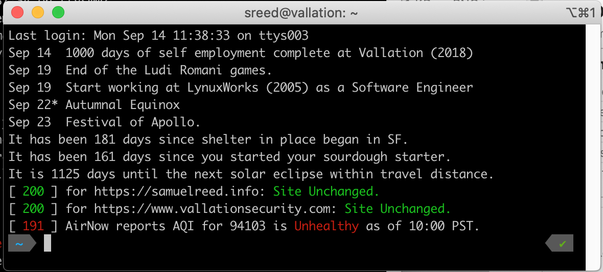

# srtermtools

This is a collection of terminal tools, usually triggered as part of a chain of .*rc files in order to display a few reminders and checks. 

Example of outputs:


* daycounter - gives a console output for the # of days since or before an upcoming event. Nice to keep track of accomplishments, upcoming events, or check how long since something has happened such as accidents on the factory floor.
* sitecheck - performs quick fuzzy hashes of websites and can check up on the hashes to identify various degrees of bit changes. Intended as a lightweight tripwire for changes or if the site is unavailable.
* aqicheck - checks air quality index for a zipcode, defaulting to the author's home. You will need an API key by signing up for one at https://docs.airnowapi.org/login and storing it in `~/.aqi.ini`.
* routerrebooter (DEPRECATED) - performs quick resets and port forwarding changes for the ancient Technicolor brand TC8305C router. It is pretty janky, and the whole request/resp flow was reverse engineered with a proxy since there is no API. 

## Installation

Install Python dependencies:
```bash
pip3 install -r requirements.txt
```

Install developer tooling:
```bash
pip3 install -r requirements-dev.txt
pre-commit install
```

**Note**: The `ssdeep` package requires system libraries. Use the provided install script for automated setup:
```bash
./install_ssdeep.sh
```

Or install manually (recommended: use the same interpreter you run tools with, e.g. pyenv Python):
- **macOS**: `brew install ssdeep && python -m pip install ssdeep`
- **Debian/Ubuntu**: `sudo apt-get install libfuzzy-dev && python -m pip install ssdeep`
- **Fedora/RHEL**: `sudo dnf install ssdeep-devel && python -m pip install ssdeep`

## Testing

How do I run the tests?
* python3 -m unittest discover -s tests -p '*_test.py'

Local validation only:
* ruff check .
* black --check .

To check test coverage:
* coverage erase; coverage run -m unittest discover -s tests -p '*_test.py'; coverage report

This repository intentionally does not use GitHub-hosted CI or Dependabot. Run checks locally when needed.

## Copilot Workflow Assets

This repository includes Copilot collaboration assets:
- `.github/copilot-instructions.md` for project-specific coding behavior
- `.github/prompts/` reusable prompts for common tasks (`new-tool`, `refactor-safe`, `add-tests`)
- issue templates for bug, feature, and structured Copilot implementation tasks
- a PR template with validation and Copilot review checklist

**DayCounter Tool**
```
Usage:
    daycounter.py countdown <eventdate> <event>...
    daycounter.py countup <eventdate> <event>...
```
daycounter.py is useful to keep track of major upcoming deadlines or how long something has been happening. The countdown always uses the phrase "It is X days until Y." and countup uses the phrase "It has been X days since Y."

**SiteCheck Tool**
```
Usage:
    sitecheck.py hash <url>
    sitecheck.py check <url> <lasthash>
```
This is cooked up as a quick sanity check to pull down a page and perform a fuzzy hash on the URL using ssdeep. ssdeep is a context triggered piecewise hash (CTPH), and has some interesting use cases for identifying things that are almost the same rather than identical. It can give you a rough gauge as to how much the input has varied from the original input, so it's useful just to use as both a health check and to determine if the pages I'm monitoring have been modified.

**AQICheck Tool**
```
Usage:
    aqicheck.py [<zipcode>] [--MOD|--USG|--UH|--VUH|--HAZ]
```
aqicheck.py will hit the AIRNow API and fetch a json blob containing both ozone and PM2.5 (think ground level), if you have registered for an API Key. These keys are free for anyone who wants to register, with the caveat that you do not hammer the API. In order to comply with this, aqicheck.py uses the requests_cache package to hold onto the last request that matches the provided parameters for one hour. By default, it will fetch AQI for the northen end of San Francisco's Mission district. If a zipcode is provided as a first optional parameter, it will fetch for that zipcode. The --MOD, --USG, --UH, --VUH, --HAZ all correspond to Moderate, Unsafe for Sensitive Groups, Unhealthy, Very Unhealthy, and Hazardous readings. If those flags are set, the command will not provide an output unless it is at least at those levels. This is intended for leaving a basic call inside a file like a .zshrc, such as "aqicheck.py 90210 --USG", which then will only alert the launcher of a terminal when their location in Beverley Hills has become bad enough for a mask amongst sensitive groups.

**Old School Minimalist Calendar Reminder Tool**
```
Usage:
    oldcal.py [options] [<file>...]
    oldcal.py [options] <directory>

Options:
    -A <days>  Show events for next <days> days [default: 0]
```
oldcal.py will provide some funcitonality that is missing in modern Linux and MacOS: the original calendar reminder system. Not to be confused with cal, calendar was a tool to parse out calendar files and remind people of dates like holidays. It was removed from MacOS and most modern distros, but still lives on with extensive libraries for it on BSD systems. While I was looking to replace it, I discovered the remind command, but couldn't get exactly the output I wanted. I ended up creating oldcal.py to just carry over the features I wanted, along with calender2remind.py to convert a large number of my own personal calendar files over into the remind file format. Admittedly, this isn't my own code but fully generated with Github Copilot (Claude 4), and I wanted the functionality but not the effort to write it myself. Amazing what these AI generators can do in a few minutes.

**Ollama Update**
```
Usage:
    ollama_update.py
```
This is a script to parse the installed LLMs with Ollama, list them, loop over each calling the command to update them. Ollama itself does not have an "update all my local LLMs" command, forcing you to type out ollama commands to update each. For me, I have about 15 local LLMs to work with, so this saves a lot of time.

